<div align="center">

# UrbanFlow
### Graph-Based, Weather-Aware Multi-Horizon Traffic Forecasting

**A research-to-dashboard project for forecasting traffic speeds across a 207-sensor network.**

[](https://www.python.org/)
[](https://pytorch.org/)
[](https://fastapi.tiangolo.com/)
[](https://react.dev/)
[](https://vite.dev/)

</div>

> **Live demo:** [Open UrbanFlow Dashboard](https://urban-flow-sand.vercel.app/). The frontend is publicly deployed on Vercel and includes an interactive historical replay with 207 sensors, four forecast horizons (15, 30, 45, and 60 minutes), and 12 saved demonstration samples.
>
> **Important limitation:** The public demo uses saved historical model forecasts when the API is unavailable. It is not a live traffic feed, and the FastAPI inference service currently runs locally rather than on a public backend.

---

## At a glance

| Component | Current implementation |
|---|---|
| Forecast targets | Traffic speed across 207 sensors |
| Historical input | 12 time steps at 5-minute intervals (60 minutes) |
| Weather context | 6 features per time step |
| Forecast horizons | 15, 30, 45 and 60 minutes |
| Model family | Graph-based spatial learning + Transformer temporal learning + weather fusion |
| Inference service | FastAPI |
| Interactive interface | React + Vite |
| Evaluation baseline | Persistence (last observed traffic speed) |
| Current demo mode | Historical sample replay |

## Why UrbanFlow?

Traffic is both **spatial** and **temporal**: nearby or connected sensors can influence one another, and conditions change over time. Weather can provide additional context. UrbanFlow brings these signals into one forecasting pipeline and exposes the outputs through an interactive dashboard and API.

The project covers the workflow from data preparation and model experiments to evaluation, inference, and visualization.

## Explore the dashboard
The public dashboard provides traffic-network visualization, multi-horizon forecasts, sensor exploration, weather context, hotspots, and model/system information.

**Public demo:** [urban-flow-sand.vercel.app](https://urban-flow-sand.vercel.app/)

The historical replay contains 12 saved samples collected from the existing model API. Use **Next Sample** to explore different saved forecasts. When the local API is unavailable, the frontend falls back to these saved samples. Displayed forecasts should be interpreted as historical demonstrations, not current traffic conditions.

Screenshots of the deployed interface can be added under `docs/images/` to illustrate the actual user experience.

## Architecture

```text
Historical traffic sequence (12 × 207) ─┐
                                        ├─> Spatial / temporal representations
Sensor graph ────────────────────────────┘                 │
                                                          ├─> Feature fusion
Weather sequence (12 × 6) ─────────────────────────────────┘
                                                          │
                                      Multi-horizon prediction heads
                                                          │
                            15 min · 30 min · 45 min · 60 min
                                                          │
                                           FastAPI inference API
                                                          │
                                          React dashboard / replay
```

### Main modeling ideas

1. **Spatial relationships:** graph-based learning represents relationships between sensors.
2. **Temporal dynamics:** Transformer components process the historical sequence.
3. **Environmental context:** six weather features are fused with traffic representations.
4. **Multi-horizon output:** separate outputs provide forecasts at 15, 30, 45 and 60 minutes.

The current inference checkpoint is:

`models/urbanflow_final_gnn_transformer_weather_multihorizon.pth`

## Evaluation results

### Raw model — verified multi-horizon test

The verified evaluation scores predictions against raw METR-LA observations that are finite and non-zero; interpolated values are excluded from the scoring mask. MAE and RMSE are in miles per hour (mph); lower is better.

| Horizon | Model MAE (mph) | Model RMSE (mph) | MAE change vs. persistence |
|---:|---:|---:|---:|
| 15 minutes | 3.731 | 6.583 | 7.12% worse |
| 30 minutes | 4.210 | 7.594 | 0.82% worse |
| 45 minutes | 4.625 | 8.416 | 3.21% better |
| 60 minutes | 4.988 | 9.075 | 6.44% better |

The raw model beats persistence by MAE at 45 and 60 minutes, but not at 15 and 30 minutes. This distinction matters: model error should not be presented without the baseline comparison.

### 30-minute validation-selected blend — held-out test

| Method | MAE (mph) | RMSE (mph) |
|---|---:|---:|
| Raw model | 4.210 | 7.594 |
| Persistence baseline | 4.176 | 7.983 |
| **50/50 model–persistence blend** | **3.919** | **7.304** |

The 50/50 blend reduces 30-minute test MAE by **6.15% relative to persistence**. Its weights were selected on validation data only and then evaluated on the held-out test split. This is a separate evaluation from the raw-model multi-horizon results above.

**Evaluation artifacts**

- `results/urbanflow_verified_test_results.csv`
- `results/urbanflow_verified_test_audit.json`
- `results/urbanflow_test_30min_blend_once.csv`
- `results/urbanflow_test_30min_blend_once_audit.json`

Historical benchmark files may use different evaluation masks or procedures. Do not compare them as though they are directly equivalent. These evaluations also do not, by themselves, prove that weather features improve accuracy; that claim requires a controlled ablation study.

## Technology stack

- **Machine learning:** Python, PyTorch, NumPy, pandas
- **API:** FastAPI, Uvicorn
- **Frontend:** React, Vite, JavaScript
- **Visualization:** MapLibre GL, Recharts
- **Research:** Jupyter notebooks, CSV/JSON evaluation artifacts

## Repository layout

```text
Urbanflow/
├── data/                  # Traffic, weather and graph data (where available)
├── docs/                  # Documentation and evaluation guides
├── frontend/              # React dashboard
├── models/                # Model checkpoints
├── notebooks/             # Data, modeling and evaluation experiments
├── results/               # Metrics, audits and diagnostics
├── scripts/               # Evaluation utilities
├── src/                   # API and inference implementation
├── README.md
└── .gitignore
```

The working repository also contains experimental artifacts. The tree above is a conceptual overview, not an exhaustive inventory.

## Run locally

These commands describe the current local development workflow. A fresh-machine installation should be tested separately because the local Python virtual environment and local data files are not automatically portable.

### 1. Start the API

From the repository root:

```bash
./.venv/bin/python -m uvicorn src.api:app --host 127.0.0.1 --port 8000
```

In another terminal, check health:

```bash
curl http://127.0.0.1:8000/health
```

The local development API has previously returned a healthy status for the UrbanFlow Final Model.

### 2. Start the frontend

Open another terminal:

```bash
cd frontend
npm install
npm run dev
```

Open the local address printed by Vite. Keep the API running in the first terminal.

The frontend currently defaults to `http://127.0.0.1:8000` for API requests. That address is suitable only for local development; it will not work for visitors to a publicly hosted frontend.

### 3. Important setup notes

- The backend needs the final checkpoint and its required graph, scaler, and input artifacts.
- A clean installation requires documented Python dependencies and the appropriate dataset/model assets.
- The current setup uses Apple Silicon MPS when available; CPU or cloud hosting requires its own dependency and performance checks.
- Do not upload secrets, personal credentials, or restricted/raw datasets to a public repository.
- Before deployment, configure a public API URL, CORS allow-list, and hosting-compatible model/data access.

## API endpoints

| Endpoint | Purpose |
|---|---|
| `GET /health` | API/model health |
| `GET /weather-data` | Weather payload used by the application |
| `GET /demo-replay?sample_index=0` | Historical replay sample and multi-horizon predictions |

The replay endpoint uses historical inputs. It should not be described as a real-time traffic endpoint. See `src/api.py` for the implementation and response structure.

## Evaluation methodology

The repository includes separate tools for verified multi-horizon scoring, validation-based blend selection, held-out blend evaluation, and per-sensor diagnostics.

The verified multi-horizon evaluation:

- uses the final GNN–Transformer–weather checkpoint;
- evaluates against raw, finite, non-zero METR-LA observations;
- excludes interpolated values from the scoring mask;
- compares model and persistence on the same observed targets;
- writes metrics and audit metadata to separate CSV/JSON files; and
- avoids silently overwriting existing verified results.

Consult each audit JSON when reporting a metric. Evaluation procedures and masks can differ between historical experiments.

## Limitations

- The dashboard is currently a historical replay demo, not a live traffic-monitoring product.
- Performance depends on the dataset, target alignment, observation mask, split and evaluation method.
- The raw model does not beat persistence at every horizon.
- The reported 30-minute blend result does not establish that blending helps at all horizons.
- Weather-feature benefit has not been established by these results alone.
- Public deployment and clean-machine reproducibility must be tested independently.


## Roadmap

- [x] Deploy the React frontend publicly on Vercel.
- [x] Add a historical replay fallback with 12 saved model-generated samples.
- [x] Document verified multi-horizon evaluation and persistence-baseline comparisons.
- [ ] Find a suitable no-cost public backend for FastAPI/PyTorch inference.
- [ ] Complete a controlled weather-feature ablation study.
- [ ] Document clean environment installation and data/model acquisition.
- [ ] Capture and review genuine screenshots of the deployed interface.
- [ ] Add dataset attribution, references, and an appropriate license.
- [ ] Review repository contents for secrets, large files, and unnecessary backup artifacts.

## Research integrity

UrbanFlow reports raw-model and blended results separately, uses a persistence baseline, and retains evaluation audit files. Performance claims should always identify the forecast horizon and evaluation procedure. The project is a forecasting prototype and research/engineering demonstration, not an operational traffic-control system.

---

**Status:** The React frontend is publicly deployed on Vercel. The public dashboard supports a 12-sample historical replay with four forecast horizons and 207 sensors. The FastAPI inference service currently runs locally; public backend hosting has not been completed. Repository documentation and evaluation artifacts are available for review, with further cleanup and reproducibility work remaining.

---

## Dashboard Screenshots

### Command Center — Network Overview

The Command Center presents the 207-sensor METR-LA network, forecast horizon controls, network-level metrics, and a geographic view of sensor locations.

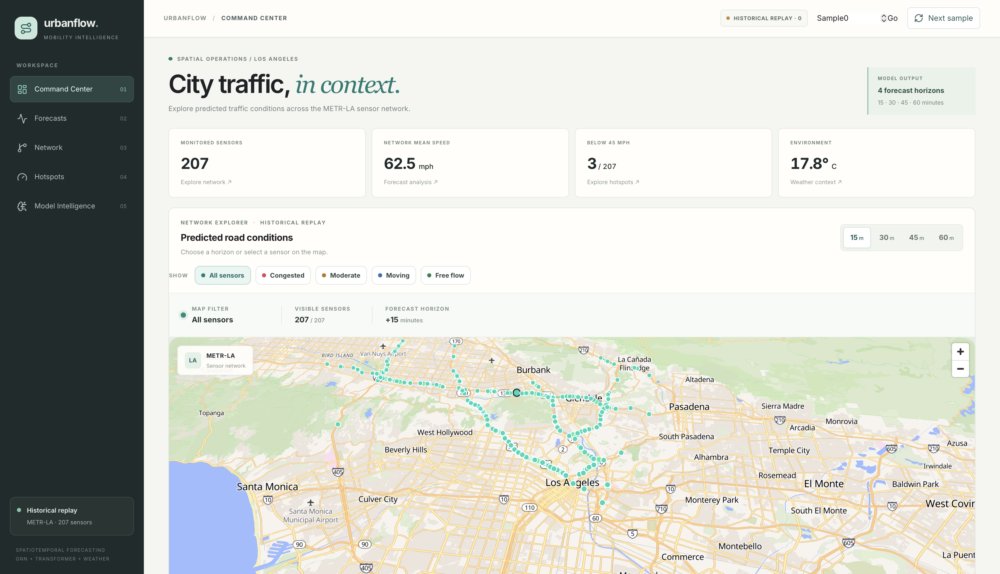

### Command Center — Sensor and Weather Details

The lower dashboard section shows the selected sensor's predicted speed, multi-horizon outputs, network outlook, and weather context.

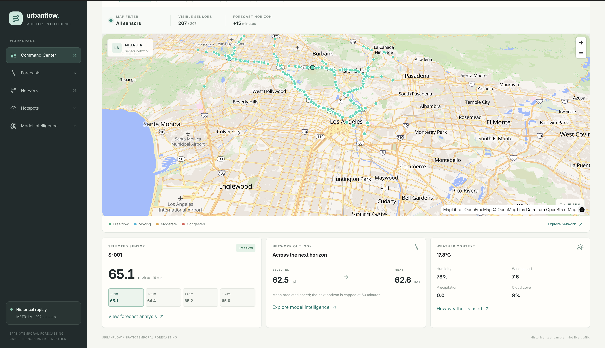

> **Demo status:** These screenshots show the historical replay interface. They do not represent a live traffic feed.

### Forecasts — Multi-Horizon Prediction

The Forecasts page visualizes the historical replay predictions across four horizons: 15, 30, 45, and 60 minutes. It includes the 207-sensor prediction field, predicted network speed, and traffic-state summaries.

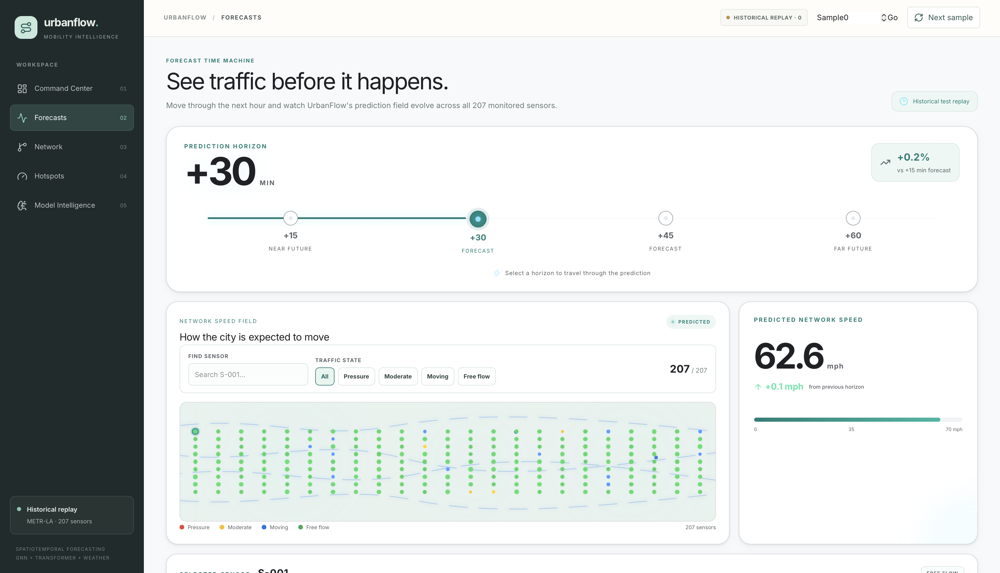

### Forecasts — Sensor-Level Details

The detailed view compares predicted speeds across forecast horizons and summarizes network evolution and traffic-state categories.

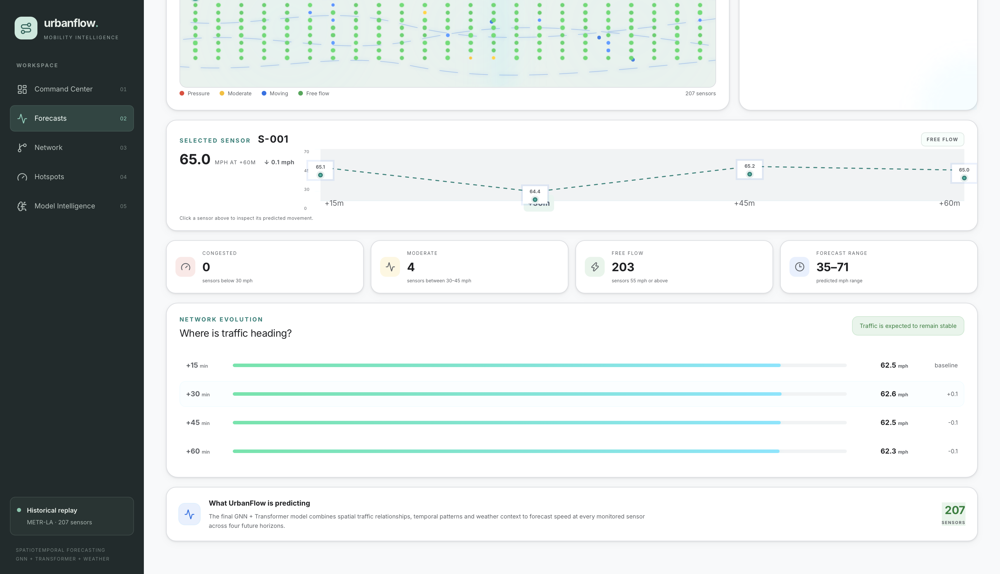

### Network — Spatial Graph Explorer

The Network page visualizes the model's sensor relationships and spatial context. It reports 207 sensor nodes, 1,722 model graph links, and 4.0% graph density. Rendered links are filtered for readability; they should not all be interpreted as physical road connections.

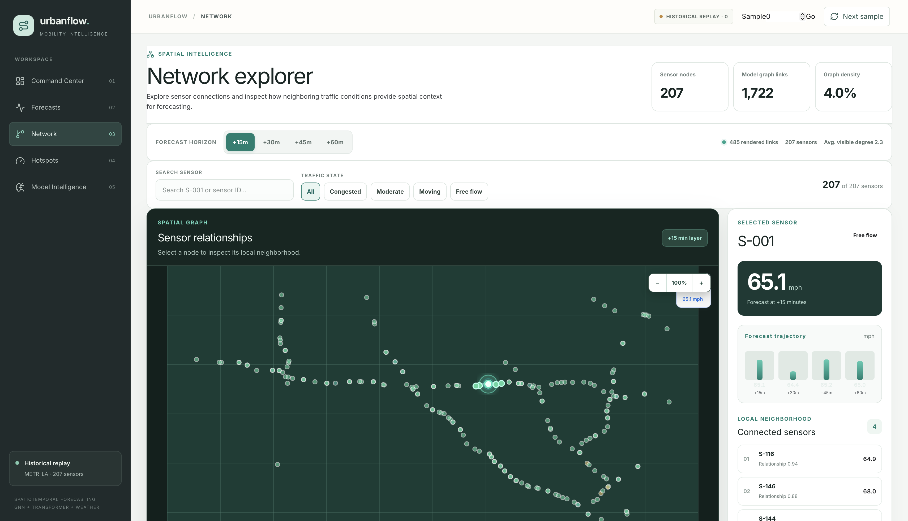

### Network — Sensor Neighborhood

The detailed view shows a selected sensor's predicted speed, forecast trajectory, connected neighbors, and graph statistics.

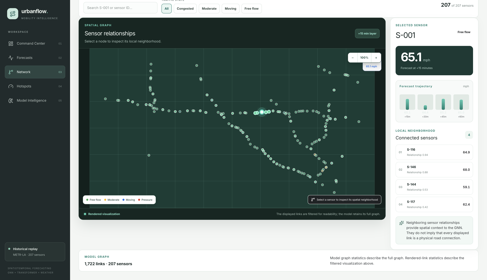

### Hotspots — Forecast-Based Traffic Signals

The Hotspots page ranks sensor locations by predicted speed and groups them into traffic-state categories. Users can explore the 15-, 30-, 45-, and 60-minute forecast horizons and inspect how predicted conditions change.

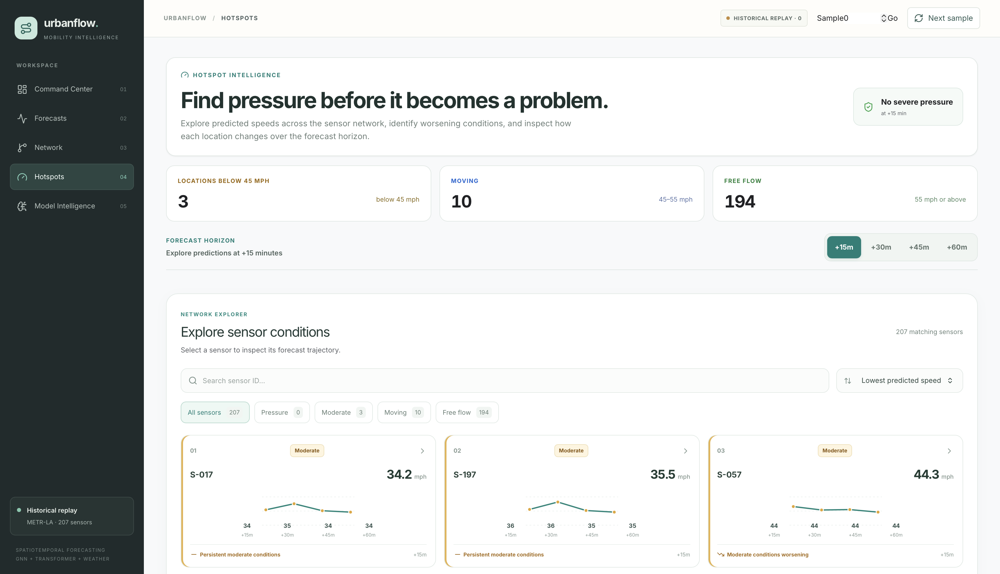

### Hotspots — Sensor-Level Forecasts

The ranked sensor cards show predicted speeds and trajectories across the forecast horizons, helping users identify locations that may warrant closer inspection.

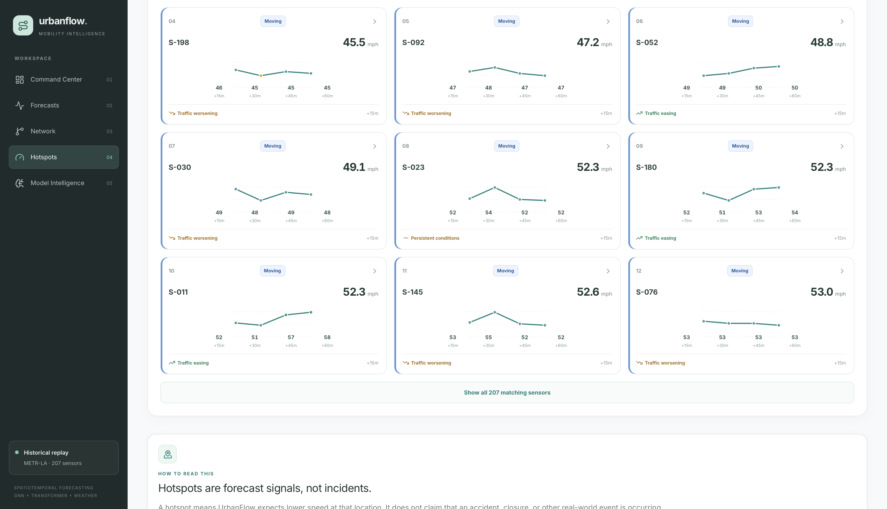

### Hotspots — Interpreting Forecast Signals

Hotspots are model predictions, not confirmed incidents. The interface explicitly distinguishes forecast-based pressure from real-world reports.

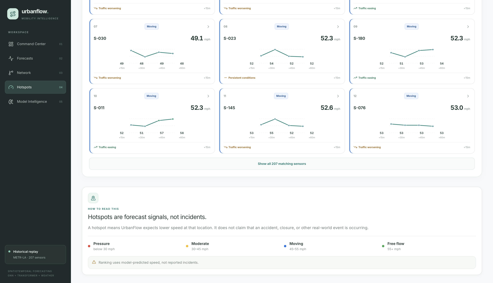


---

## Model Intelligence

UrbanFlow combines graph-based spatial context, Transformer-based temporal modelling, and six weather features to produce traffic-speed forecasts for 207 sensors at 15-, 30-, 45-, and 60-minute horizons.

### Forecasting Architecture

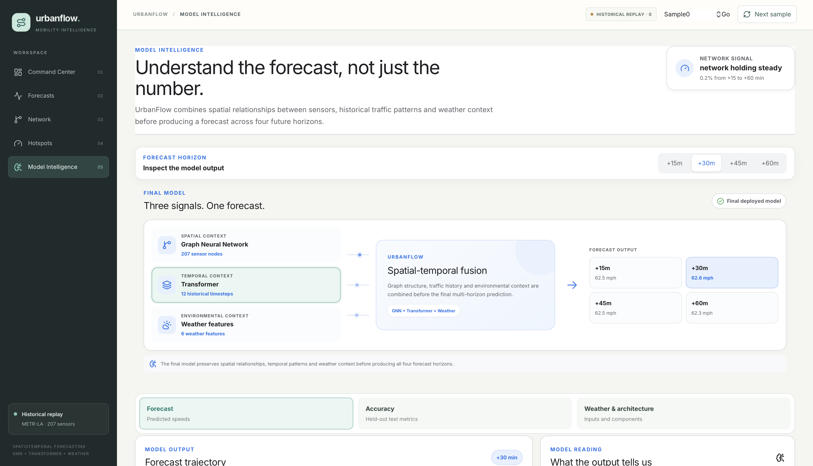

The architecture explorer illustrates the roles of the spatial graph, Transformer encoder, and weather-feature fusion.

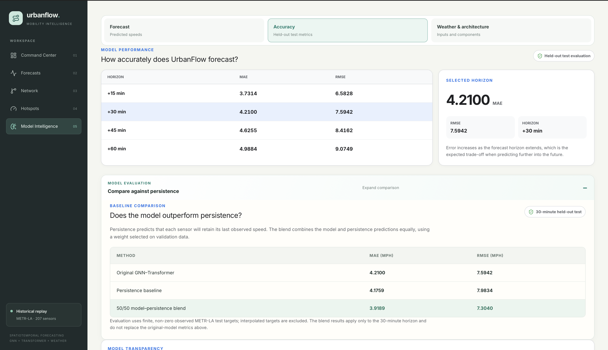

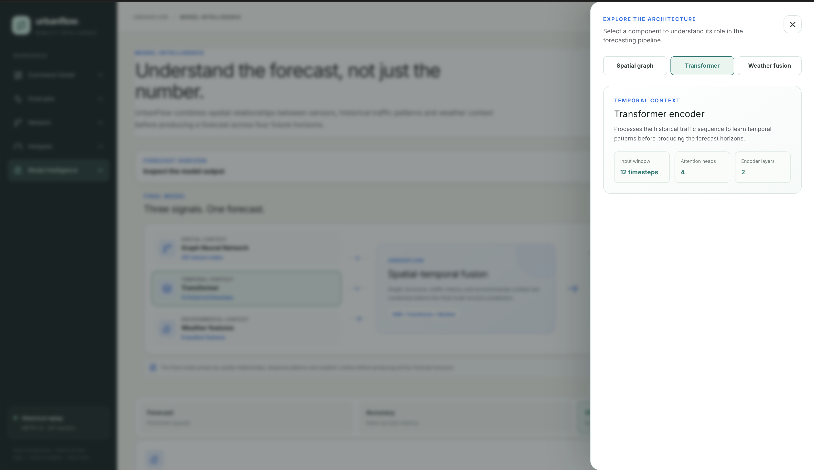

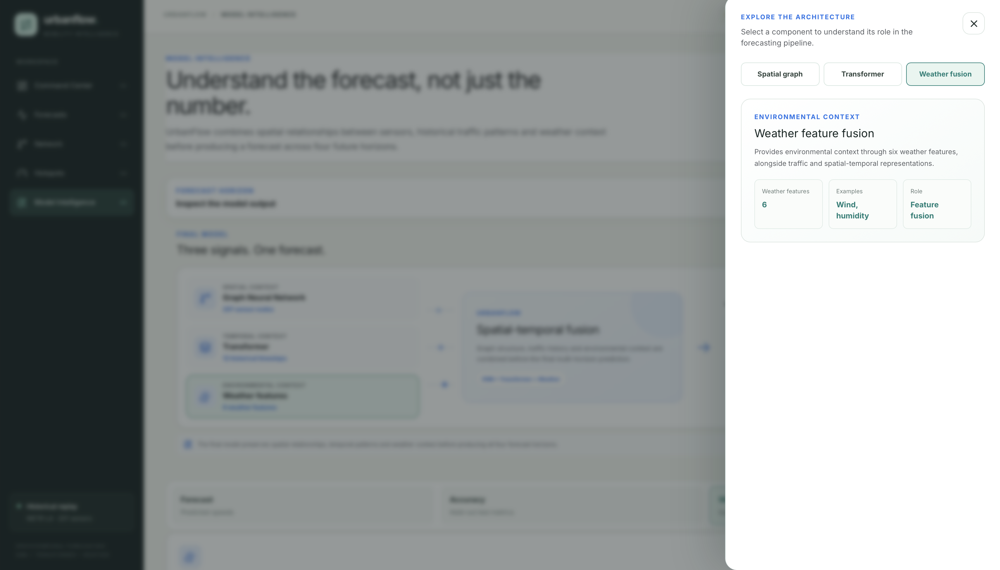

### Held-Out Evaluation

The dashboard reports raw-model metrics separately from the persistence baseline and the 50/50 model–persistence blend. The blend results apply specifically to the 30-minute horizon.

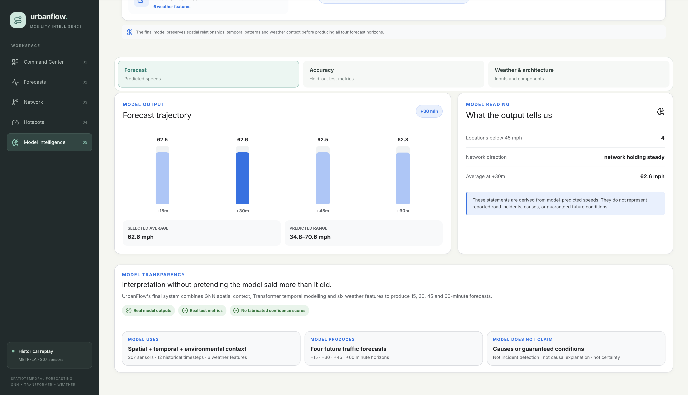

### Weather Context

The model interface displays temperature, humidity, precipitation, wind speed, pressure, and cloud cover as environmental inputs.

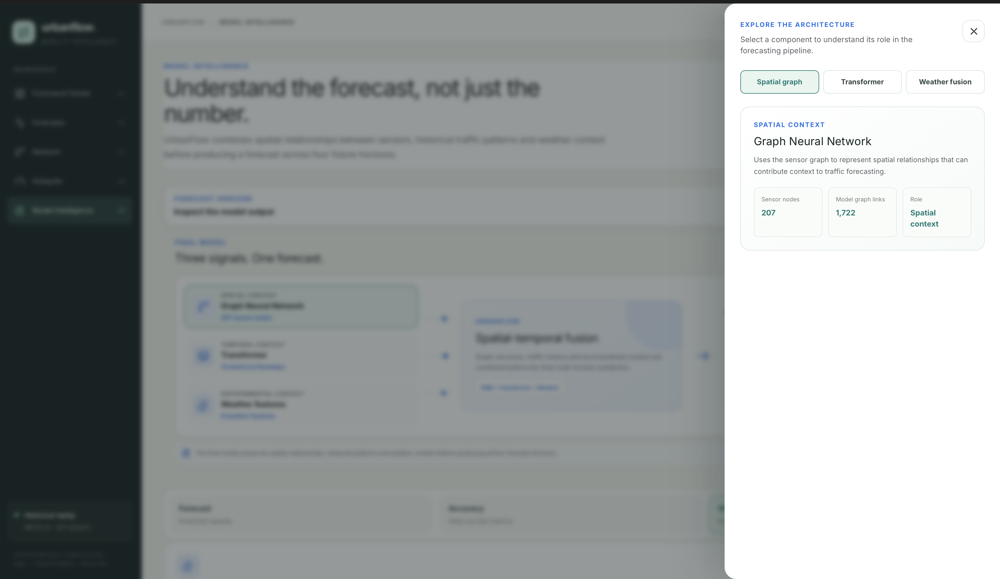

### Model Transparency

UrbanFlow presents model outputs as forecasts, not as confirmed incidents or guaranteed future conditions.

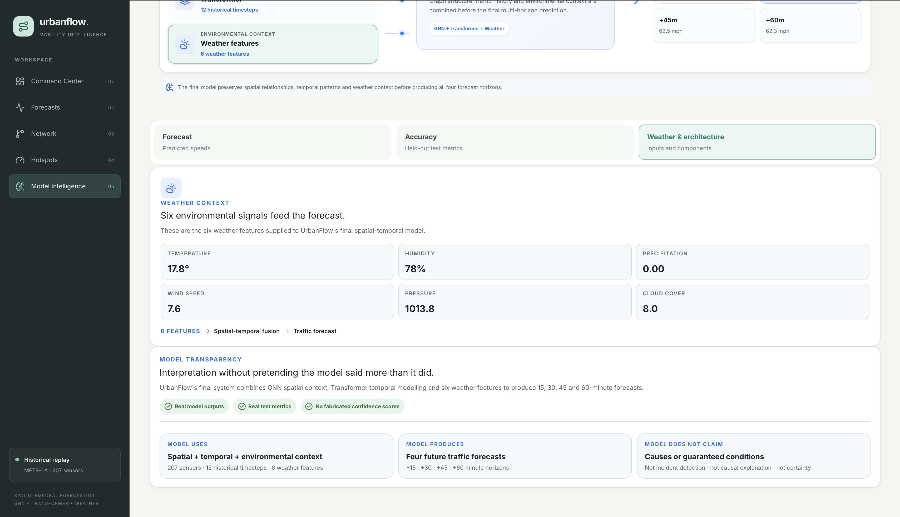

> **Evaluation note:** The screenshots show the local historical-replay interface. They do not represent live traffic or prove that weather features independently improve predictive accuracy.
